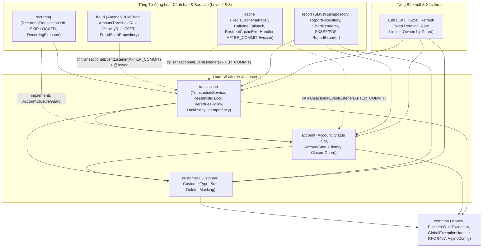
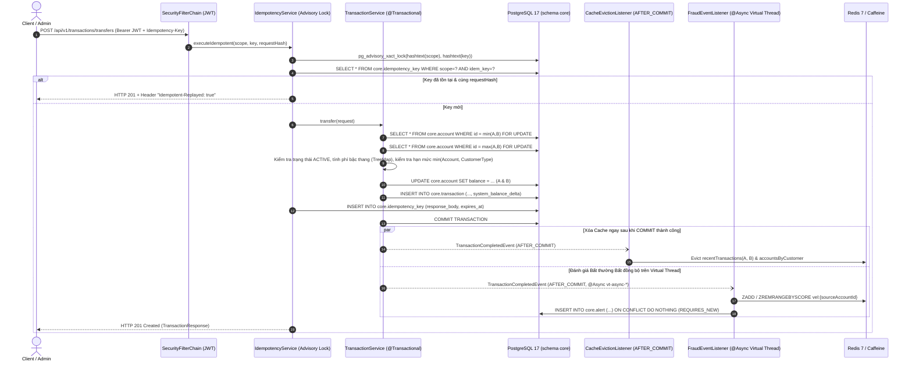
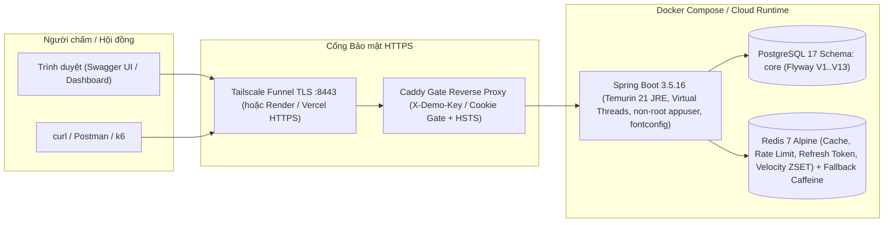

# Kiến trúc Hệ thống — Core Banking System (`v1.0.0`)

Tài liệu này mô tả chi tiết kiến trúc **Modular Monolith (Package-by-Feature)**, luồng xử lý giao dịch tiền tệ nguyên tử kết hợp sự kiện bất đồng bộ trên **Java 21 Virtual Threads**, và sơ đồ triển khai của hệ thống.

- **Sơ đồ Thực thể Liên kết (ERD):** xem [`docs/erd.md`](erd.md)
- **Hồ sơ Quyết định Kiến trúc (ADR-001..ADR-015):** xem [`docs/adr.md`](adr.md)
- **Ghi chú Kỹ thuật từng tính năng (Dev Notes):** xem [`docs/dev-notes/README.md`](dev-notes/README.md)

---

## 1. Sơ đồ Phụ thuộc Module (Modular Monolith — 9 Domain Modules)

Hệ thống được chia thành 9 module nghiệp vụ độc lập bên trong `com.example.corebanking`. Phụ thuộc giữa các module luôn **một chiều (acyclic)**; đối với các ràng buộc chéo (như kiểm tra lịch giao dịch định kỳ trước khi đóng tài khoản), module bên dưới định nghĩa **Port Interface** (`AccountClosureGuard`) để đảo chiều phụ thuộc (Dependency Inversion).

---

## 2. Luồng Giao dịch Nguyên tử & Xử lý Sự kiện Sau Commit (`AFTER_COMMIT`)

Mọi biến động số dư (`DEPOSIT`, `WITHDRAWAL`, `TRANSFER`, `PAYMENT`, `REVERSAL`) đều tuân thủ nghiêm ngặt ranh giới giao dịch ACID của PostgreSQL 17:

---

## 3. Sơ đồ Triển khai (Deployment & Live Demo Topology)

