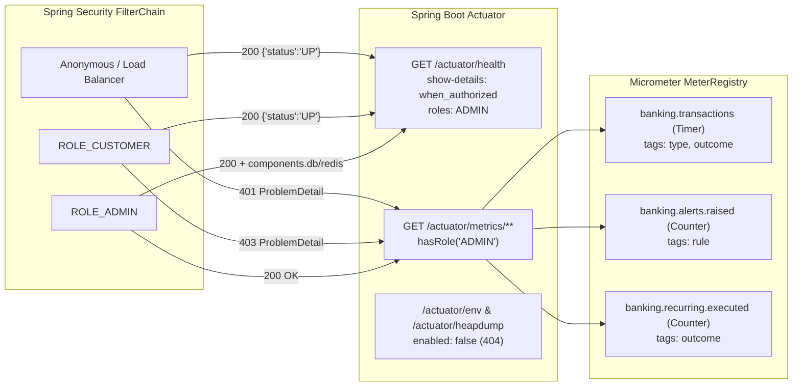

# Story 4.8: Actuator Metrics and Virtual Threads

- **Mã yêu cầu:** `L3-09` [ĐỀ], `L3-10` [ĐỀ], `FR-24`, `NFR-4`, `ADR-015`
- **Pull Request:** [#40](https://github.com/tsennguyen/corebank-java-assessment/pull/40)

---

## 1. Bài toán & Mục tiêu

Ở cấp độ vận hành (Level 3 — `L3-09`, `L3-10`), hệ thống Core Banking cần đáp ứng đồng thời hai yêu cầu phi chức năng và giám sát:
1. **Khả năng quan sát (Observability) an toàn theo nguyên tắc đặc quyền tối thiểu (Least Privilege):**
   - Load balancer (Render / Docker health check / UptimeRobot) cần gọi `GET /actuator/health` không cần token để biết ứng dụng còn sống (`{"status":"UP"}`), nhưng **không được lộ** cấu trúc hạ tầng (`db`, `redis`) cho người lạ hoặc khách hàng (`ROLE_CUSTOMER`). Chỉ quản trị viên (`ROLE_ADMIN`) mới được xem chi tiết `components.db` và `components.redis`.
   - Quản trị viên cần theo dõi các chỉ số nghiệp vụ thời gian thực qua `GET /actuator/metrics`:
     - `banking.transactions` (`Timer`, gắn nhãn `type` = `DEPOSIT|WITHDRAWAL|TRANSFER|PAYMENT|REVERSAL` và `outcome` = `SUCCESS|FAILURE`).
     - `banking.alerts.raised` (`Counter`, gắn nhãn `rule` = `AMOUNT_THRESHOLD|VELOCITY`).
     - `banking.recurring.executed` (`Counter`, gắn nhãn `outcome` = `SUCCESS|FAILURE`).
   - Các endpoint nhạy cảm có nguy cơ lộ biến môi trường hoặc bộ nhớ (`env`, `heapdump`) tuyệt đối không được phơi bày ra web.
2. **Xử lý đồng thời hiệu quả với Java 21 Virtual Threads (`L3-10`, `NFR-4`, `ADR-015`):**
   - Bật `spring.threads.virtual.enabled=true` để Tomcat request threads, `@Async` (`applicationTaskExecutor`, `fraudAsyncExecutor`), `@Scheduled` và các truy vấn báo cáo song song (`CompletableFuture.supplyAsync`) đều chạy trên Virtual Threads.
   - Đảm bảo không có khối `synchronized` nào bao quanh thao tác I/O trong toàn bộ mã nguồn để tránh hiện tượng **Carrier Thread Pinning** trên Java 21.
   - Giới hạn HikariCP connection pool phù hợp với từng môi trường (`maximum-pool-size: 10` ở `local`, `5` ở `prod` tương thích giới hạn kết nối của Supabase).

---

## 2. Thiết kế Kỹ thuật

### 2.1. Phân quyền Actuator Endpoints (`application.yml` & `SecurityConfig`)
- Trong `application.yml`:
  - `management.endpoints.web.exposure.include: health,info,metrics`
  - `management.endpoint.health.show-details: when_authorized` kèm `management.endpoint.health.roles: ADMIN` — đảm bảo ngay cả người dùng đã đăng nhập với `ROLE_CUSTOMER` cũng không xem được `components.db` hay `components.redis`.
  - `management.endpoint.env.enabled: false` và `management.endpoint.heapdump.enabled: false` (phòng vệ nhiều lớp ngay cả khi cấu hình exposure bị thay đổi).
- Trong `SecurityConfig`:
  - Mở `.permitAll()` cho `/actuator/health`, `/actuator/health/**`, `/actuator/info`.
  - Áp dụng `.requestMatchers("/actuator/metrics", "/actuator/metrics/**", "/actuator/**").hasRole("ADMIN")`, trả về chuẩn RFC 9457 `ProblemDetail` (`401 UNAUTHORIZED` khi thiếu token, `403 ACCESS_DENIED` khi dùng token `CUSTOMER`).

### 2.2. Ghi nhận Custom Business Metrics (`Micrometer`)
- **`TransactionService` (`banking.transactions`):**
  - Sử dụng `Timer.Sample` (`Timer.start(meterRegistry)`) bên trong hàm bọc `recordTransactionTimer(TransactionType, Supplier<T>)` cho cả 6 luồng thực thi: `executeDeposit`, `executeWithdraw`, `executeTransfer`, `executePayment`, `reverseTransaction`, và `executeScheduledTransaction`.
  - Nhờ khối `try / catch (RuntimeException) / finally`, mọi giao dịch thất bại do vi phạm quy tắc nghiệp vụ (`INSUFFICIENT_BALANCE`, `LIMIT_EXCEEDED`, `SAME_ACCOUNT_TRANSFER`, v.v.) đều được ghi nhận chính xác với `outcome=FAILURE` kèm thời gian xử lý trước khi ném ngoại lệ ra ngoài.
- **`RecurringExecutor` (`banking.recurring.executed`):**
  - Tăng bộ đếm `banking.recurring.executed` với `outcome=SUCCESS` khi thực thi lệnh định kỳ thành công và `outcome=FAILURE` khi bắt được `BusinessRuleException` hoặc `ResourceNotFoundException`.
- **`AlertService` (`banking.alerts.raised`):**
  - Tăng bộ đếm `banking.alerts.raised` với tag `rule` (`AMOUNT_THRESHOLD` hoặc `VELOCITY`) mỗi khi `INSERT ... ON CONFLICT DO NOTHING` thực sự chèn được cảnh báo mới.

### 2.3. Virtual Threads, HikariCP Pool Sizing & Loại bỏ Carrier Pinning
- Thay thế toàn bộ `synchronized (rotationLock)` trong `RefreshTokenStore` (nơi có thể gọi `StringRedisTemplate` qua mạng) bằng `ReentrantLock` (`rotationLock.lock()` / ` finally { rotationLock.unlock(); }`), giúp toàn bộ `backend/src/main/java` đạt **0 khối `synchronized`**.
- Kiểm chứng tự động bằng bài test tích hợp `ActuatorMetricsAndVirtualThreadsIT`:
  1. Gửi HTTP request thật qua `java.net.http.HttpClient` tới embedded Tomcat (`WebEnvironment.RANDOM_PORT`) và kiểm tra `Thread.currentThread().isVirtual() == true` ngay trong `OncePerRequestFilter`.
  2. Kiểm tra `CompletableFuture.supplyAsync(() -> Thread.currentThread().isVirtual(), applicationTaskExecutor)` và `fraudAsyncExecutor` đều trả về `true`.
  3. Quét toàn bộ cây thư mục `src/main/java` xác nhận không có từ khóa `synchronized`.

---

## 3. Các Phương án Đã Cân nhắc

| Quyết định | Phương án lựa chọn | Phương án bị loại & Lý do |
|---|---|---|
| **Ẩn chi tiết `/actuator/health` với `ROLE_CUSTOMER`** | `show-details: when_authorized` + `roles: ADMIN` | Chỉ dùng `show-details: when_authorized` (mặc định): bất kỳ tài khoản `CUSTOMER` nào đăng nhập cũng thấy tên database (`PostgreSQL`) và trạng thái Redis. |
| **Đo lường giao dịch (`banking.transactions`)** | Dùng Micrometer `Timer` (có cả `COUNT`, `TOTAL_TIME`, `MAX`) trong `try/finally` | Chỉ dùng `Counter`: không đo được độ trễ (latency) khi chờ khóa bi quan `FOR UPDATE` dưới tải cao. |
| **Đồng bộ hóa trong `RefreshTokenStore`** | `java.util.concurrent.locks.ReentrantLock` | `synchronized (rotationLock)`: trên Java 21, nếu luồng Virtual Thread bị chặn khi đọc/ghi socket Redis bên trong khối `synchronized`, nó sẽ ghim (pin) OS carrier thread của `ForkJoinPool`. |
