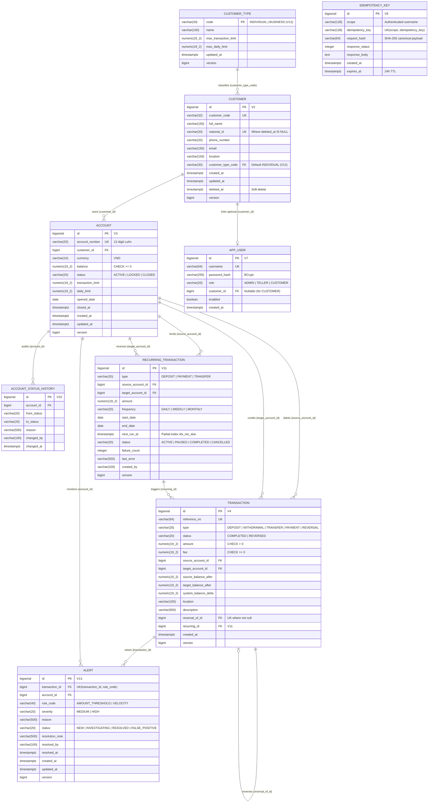

# Sơ đồ Thực thể Liên kết (Entity-Relationship Diagram — Schema `core`)

Sơ đồ dưới đây phản ánh chính xác cấu trúc các bảng trong schema `core` trên PostgreSQL 17 được quản lý bởi Flyway (`V1__init_schema.sql` → `V13__alert.sql`).

