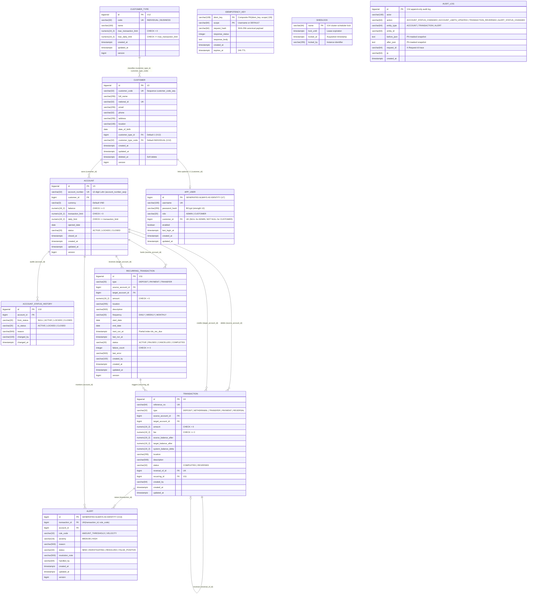

# Sơ đồ Thực thể Liên kết (Entity-Relationship Diagram — Schema `core`)

Tài liệu này mô tả chính xác cấu trúc 11 bảng trong schema `core` trên **PostgreSQL 17** được quản lý bởi **Flyway** (`V1__init_schema.sql` → `V14__scale_and_hardening.sql`), kèm danh mục toàn bộ **Chỉ mục (B-tree, Partial, Covering, Keyset Indexes)** và **Ràng buộc Toàn vẹn (`CHECK`, `UNIQUE`, `FOREIGN KEY`, `TRIGGER`)**.

---

## 1. Sơ đồ Thực thể Liên kết (`erDiagram`)

---

## 2. Danh mục Chỉ mục Tối ưu hóa (Indexes — `V2` → `V14`)

| Bảng | Tên Chỉ mục | Loại Chỉ mục | Biểu thức Cột / Điều kiện `WHERE` | Migration | Mục đích Tối ưu Truy vấn |
|---|---|---|---|---|---|
| `core.customer` | `idx_customer_location` | Partial Expression B-tree | `(COALESCE(NULLIF(TRIM(location), ''), 'UNKNOWN')) WHERE deleted_at IS NULL` | `V2`, `V8` | Thống kê phân bố khách hàng đang hoạt động theo địa điểm (`L1-10`, `GET /api/v1/statistics/customers-by-location`) |
| `core.customer` | `idx_customer_deleted_at` | B-tree | `(deleted_at)` | `V2` | Lọc khách hàng chưa xóa mềm (`deleted_at IS NULL`) |
| `core.customer` | `idx_customer_type_id` | Partial B-tree | `(customer_type_id) WHERE deleted_at IS NULL` | `V12` | Tra cứu khách hàng theo phân loại (`INDIVIDUAL` / `BUSINESS`) |
| `core.customer` | `idx_customer_type_code` | Partial B-tree | `(customer_type_code) WHERE deleted_at IS NULL` | `V12` | Lọc/kiểm tra khách hàng đang dùng mã phân loại (`L3-05`) |
| `core.account` | `idx_account_customer_id` | B-tree | `(customer_id)` | `V3` | Liệt kê danh sách tài khoản theo khách hàng (`GET /api/v1/accounts`, `GET /api/v1/me/accounts`) |
| `core.account` | `idx_account_status` | B-tree | `(status)` | `V3` | Lọc tài khoản `ACTIVE` / `LOCKED` / `CLOSED` và thống kê bậc số dư (`L1-09`) |
| `core.transaction` | `idx_tx_source_created` | Composite B-tree | `(source_account_id, created_at DESC)` | `V4` | Lịch sử giao dịch chiều ghi nợ của tài khoản và quét gian lận Velocity (`L3-03`) |
| `core.transaction` | `idx_tx_target_created` | Composite B-tree | `(target_account_id, created_at DESC)` | `V4` | Lịch sử giao dịch chiều ghi có của tài khoản (`GET /api/v1/accounts/{id}/transactions`) |
| `core.transaction` | `idx_tx_created` | B-tree | `(created_at DESC)` | `V4` | Phân trang giao dịch toàn hệ thống theo thời gian mới nhất |
| `core.transaction` | `idx_tx_type_created` | Composite B-tree | `(type, created_at DESC)` | `V4` | Lọc giao dịch theo loại (`DEPOSIT`, `WITHDRAWAL`, `TRANSFER`, `PAYMENT`, `REVERSAL`) |
| `core.transaction` | `idx_tx_source_completed_created_amount` | **Partial Covering Index** | `(source_account_id, created_at DESC) INCLUDE (amount) WHERE status = 'COMPLETED' AND type IN ('WITHDRAWAL', 'TRANSFER', 'PAYMENT')` | `V8` | **Index-Only Scan** tính tổng tiền rút/chuyển trong ngày (`sumOutgoingAmountSince`, giảm độ trễ trên 1M dòng từ `121,007 ms` xuống `0,937 ms`) |
| `core.transaction` | `idx_tx_status_created` | Composite B-tree | `(status, created_at DESC)` | `V9` | Tìm kiếm giao dịch nâng cao (`L2-04`) và stream báo cáo Excel/PDF theo kỳ (`L3-07`) |
| `core.transaction` | `idx_tx_amount_created` | Composite B-tree | `(amount DESC, created_at DESC)` | `V9` | Lọc giao dịch theo khoảng tiền (`minAmount`, `maxAmount`) và quét `AMOUNT_THRESHOLD` |
| `core.transaction` | `idx_tx_recurring_id` | Partial B-tree | `(recurring_id) WHERE recurring_id IS NOT NULL` | `V11` | Truy vết các giao dịch phát sinh từ lịch định kỳ |
| `core.transaction` | `idx_tx_src_keyset` / `idx_tx_tgt_keyset` / `idx_tx_created_id_keyset` | **Keyset Composite B-tree** | `(source_account_id, created_at DESC, id DESC)` / `(target_account_id, created_at DESC, id DESC)` / `(created_at DESC, id DESC)` | `V14` | Phân trang con trỏ Keyset Pagination $O(\log N)$ trên lịch sử giao dịch triệu dòng (`Story 6.1`) |
| `core.idempotency_key` | `idx_idempotency_expires_at` | B-tree | `(expires_at)` | `V6` | Dọn dẹp định kỳ các khóa `Idempotency-Key` hết hạn sau 24 giờ |
| `core.app_user` | `idx_app_user_customer_id` | Partial B-tree | `(customer_id) WHERE customer_id IS NOT NULL` | `V7` | Liên kết 1-1 tài khoản đăng nhập `CUSTOMER` với hồ sơ `core.customer` |
| `core.account_status_history` | `idx_acc_status_hist_account_changed` | Composite B-tree | `(account_id, changed_at DESC, id DESC)` | `V10` | Truy vấn lịch sử chuyển trạng thái của tài khoản (`L2-05`) |
| `core.recurring_transaction` | `idx_rec_due` | **Partial B-tree** | `(next_run_at ASC, id ASC) WHERE status = 'ACTIVE'` | `V11` | Quét các lệnh định kỳ đến hạn bằng `FOR UPDATE SKIP LOCKED` (`L2-07`) |
| `core.recurring_transaction` | `idx_rec_source_account` | Partial B-tree | `(source_account_id, status) WHERE source_account_id IS NOT NULL` | `V11` | Kiểm tra nhanh lệnh định kỳ đang hoạt động trước khi đóng tài khoản (`AccountClosureGuard`) |
| `core.recurring_transaction` | `idx_rec_target_account` | Partial B-tree | `(target_account_id, status) WHERE target_account_id IS NOT NULL` | `V11` | Kiểm tra lệnh định kỳ nhận tiền khi đóng tài khoản |
| `core.recurring_transaction` | `idx_rec_status_created` | Composite B-tree | `(status, created_at DESC, id DESC)` | `V11` | Phân trang danh sách lịch giao dịch định kỳ theo trạng thái |
| `core.alert` | `idx_alert_status_created` | Composite B-tree | `(status, created_at DESC, id DESC)` | `V13` | Lọc cảnh báo gian lận theo trạng thái xử lý (`NEW`, `INVESTIGATING`, ...) |
| `core.alert` | `idx_alert_account_created` | Composite B-tree | `(account_id, created_at DESC, id DESC)` | `V13` | Tra cứu cảnh báo theo tài khoản bị giám sát |
| `core.alert` | `idx_alert_rule_created` | Composite B-tree | `(rule_code, created_at DESC, id DESC)` | `V13` | Lọc cảnh báo theo quy tắc (`AMOUNT_THRESHOLD`, `VELOCITY`) |
| `core.alert` | `idx_alert_created` | Composite B-tree | `(created_at DESC, id DESC)` | `V13` | Phân trang danh sách cảnh báo toàn hệ thống |
| `core.audit_log` | `idx_audit_log_created` / `idx_audit_log_actor_created` / `idx_audit_log_action_created` | Composite B-tree | `(created_at DESC, id DESC)` / `(actor, created_at DESC, id DESC)` / `(action, created_at DESC, id DESC)` | `V14` | Tra cứu nhật ký kiểm toán bất biến theo thời gian, người thực hiện và hành động (`GET /api/v1/admin/audit-logs`, `Story 6.3`) |

*(Lưu ý: Migration `V5__drop_redundant_indexes.sql` đã chủ động xóa chỉ mục dư thừa `idx_account_number` vì cột `account_number` đã có ràng buộc `UNIQUE` tự tạo B-tree index).*

---

## 3. Danh mục Ràng buộc Toàn vẹn (`CHECK`, `UNIQUE`, `FOREIGN KEY`, `TRIGGER`)

| Bảng | Tên Ràng buộc | Loại | Định nghĩa Chi tiết | Ý nghĩa Nghiệp vụ |
|---|---|---|---|---|
| `core.customer` | `customer_customer_code_key` | `UNIQUE` | `UNIQUE (customer_code)` | Mã khách hàng (`CUS...`) duy nhất toàn hệ thống |
| `core.customer` | `customer_national_id_key` | `UNIQUE` | `UNIQUE (national_id)` | Số CCCD/CMND/ĐKKD không trùng lặp |
| `core.account` | `account_account_number_key` | `UNIQUE` | `UNIQUE (account_number)` | Số tài khoản 12 chữ số Luhn duy nhất |
| `core.account` | `fk_account_customer` | `FOREIGN KEY` | `customer_id REFERENCES core.customer(id)` | Mọi tài khoản phải thuộc về một khách hàng hợp lệ |
| `core.account` | `chk_account_balance` | `CHECK` | `balance >= 0` | Chặn tuyệt đối số dư âm ngay tại tầng CSDL |
| `core.account` | `chk_account_limits` | `CHECK` | `transaction_limit > 0 AND daily_limit >= transaction_limit` | Hạn mức ngày luôn lớn hơn hoặc bằng hạn mức từng lần |
| `core.transaction` | `transaction_reference_no_key` | `UNIQUE` | `UNIQUE (reference_no)` | Mã tham chiếu giao dịch duy nhất (chống trùng lệnh định kỳ `REC-{id}-{yyyyMMdd}`) |
| `core.transaction` | `transaction_reversal_of_id_key` | `UNIQUE` | `UNIQUE (reversal_of_id)` | Mỗi giao dịch gốc chỉ được đảo (`REVERSAL`) tối đa 1 lần duy nhất (`L1-08`) |
| `core.transaction` | `chk_tx_amount` | `CHECK` | `amount > 0` | Số tiền giao dịch luôn dương |
| `core.transaction` | `chk_tx_fee` | `CHECK` | `fee >= 0` | Phí giao dịch không âm |
| `core.idempotency_key` | `pk_idempotency_key` | `PRIMARY KEY` | `PRIMARY KEY (idem_key, scope)` | Cô lập khóa chống gửi trùng theo từng người dùng (`scope`) |
| `core.app_user` | `chk_app_user_role` | `CHECK` | `role IN ('ADMIN', 'CUSTOMER')` | Chỉ cho phép 2 vai trò hợp lệ trong hệ thống |
| `core.app_user` | `chk_app_user_customer_link` | `CHECK` | `(role = 'ADMIN' AND customer_id IS NULL) OR (role = 'CUSTOMER' AND customer_id IS NOT NULL)` | Ràng buộc chặt chẽ: `CUSTOMER` bắt buộc gắn với 1 hồ sơ khách hàng, `ADMIN` không gắn |
| `core.account_status_history` | `chk_acc_status_hist_from` / `to` | `CHECK` | `to_status IN ('ACTIVE', 'LOCKED', 'CLOSED')` | Đảm bảo nhật ký kiểm toán trạng thái tài khoản hợp lệ |
| `core.recurring_transaction` | `chk_rec_accounts_by_type` | `CHECK` | Kiểm tra cặp `(source_account_id, target_account_id)` theo từng `type` (`DEPOSIT`, `PAYMENT`, `TRANSFER`) và `source <> target` | Ngăn cấu hình sai tài khoản nguồn/đích của giao dịch định kỳ |
| `core.customer_type` | `customer_type_limits_check` | `CHECK` | `max_transaction_limit > 0 AND max_daily_limit >= max_transaction_limit` | Đảm bảo trần hạn mức phân loại khách hàng hợp lệ (`L3-06`) |
| `core.alert` | `uk_alert_tx_rule` | `UNIQUE` | `UNIQUE (transaction_id, rule_code)` | Chống sinh trùng cảnh báo khi quét lại lịch sử (`ON CONFLICT DO NOTHING`) |
| `core.alert` | `chk_alert_rule_code` / `status` | `CHECK` | `rule_code IN ('AMOUNT_THRESHOLD', 'VELOCITY')`, `status IN ('NEW', 'INVESTIGATING', 'RESOLVED', 'FALSE_POSITIVE')` | Chuẩn hóa vòng đời xử lý cảnh báo gian lận (`L3-04`) |
| `core.audit_log` | `trg_audit_log_append_only` | `TRIGGER` | `BEFORE UPDATE OR DELETE ON core.audit_log FOR EACH ROW EXECUTE FUNCTION core.prevent_audit_log_mutation()` | Đảm bảo bảng nhật ký kiểm toán là bất biến (`Append-Only` — chặn mọi thao tác sửa/xóa dòng kiểm toán, `Story 6.3`) |

